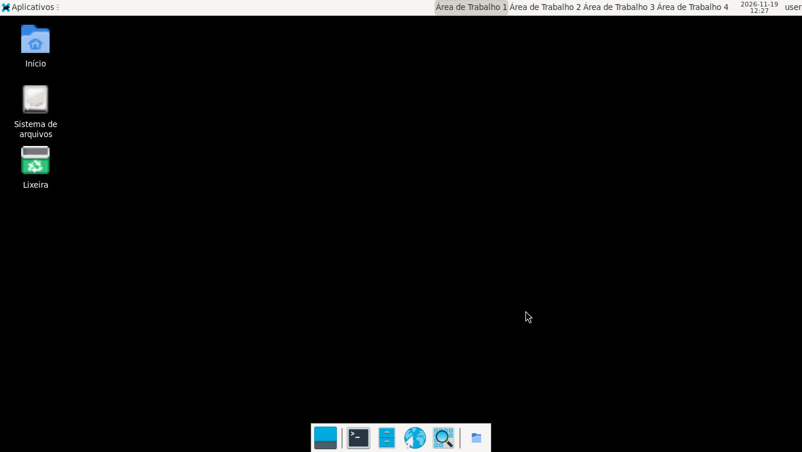
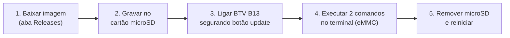

<div align="center">

# UnioBox

### TV Box Educacional — BTV B13 (Debian)

**Transformando TV Boxes apreendidas em computadores educacionais prontos para uso em escolas.**

[-0A66C2?style=flat-square)](#-o-que-já-vem-pronto)
[-A81D33?style=flat-square)](#-o-que-já-vem-pronto)
[-2284F2?style=flat-square)](#-o-que-já-vem-pronto)
[](#-sobre-e-objetivo-do-projeto)
[](LICENSE)

[Sobre](#-sobre-e-objetivo-do-projeto) •
[O que vem pronto](#-o-que-já-vem-pronto) •
[Tutorial de Instalação](#-tutorial-de-instalação) •
[Aplicativos](#aplicativos-instalados) •
[Solução de Problemas](docs/TROUBLESHOOTING.md) •
[Autores](#-autores-instituição-e-créditos)

</div>

---



## 🎯 Sobre e Objetivo do Projeto

Este projeto é uma iniciativa do curso de **Ciência da Computação da UNIOESTE — Campus de Cascavel**, desenvolvida em parceria com a **Receita Federal do Brasil**.

O objetivo é **descaracterizar aparelhos TV Box apreendidos** — removendo integralmente o sistema original e sua finalidade irregular — e transformá-los em **microcomputadores educacionais completos e prontos para uso**. A solução oferece uma alternativa de baixíssimo custo para equipar laboratórios de informática, escolas públicas e projetos de inclusão digital, ao mesmo tempo em que evita o descarte prematuro de equipamentos eletrônicos (lixo eletrônico).

---

## 💻 O que já vem pronto

A imagem disponibilizada foi construída sobre o projeto [devmfc/debian-on-amlogic](https://github.com/devmfc/debian-on-amlogic) e já entrega um ambiente pronto para o dia a dia escolar, sem necessidade de configuração manual pós-instalação:

| Recurso | Configuração incluída |
| :--- | :--- |
| **Hardware suportado** | TV Box **BTV B13** — SoC **Amlogic S905X4** (`arm64`) |
| **Sistema operacional** | **Debian Trixie** (`arm64`) |
| **Ambiente gráfico** | **XFCE4 sobre Wayland** |
| **Idioma e teclado** | Português do Brasil (**`pt-BR`**) e layout **ABNT2** |
| **Mídias removíveis** | **Montagem automática (automount)** de pendrives e cartões flash ao plugar |
| **Compatibilidade Wayland** | Bibliotecas `qt6-wayland` e `qtwayland5` pré-instaladas para apps educacionais KDE/Qt |
| **Pacote de software** | Suíte de escritório, navegador e aplicativos educacionais testados na BTV B13 |

> [!NOTE]
> **Limitação conhecida — Áudio:** O som nativo da TV Box **não funciona** nesta descaracterização da BTV B13. Por esse motivo, aplicativos que dependem de áudio para uso (como o *KLettres*) não foram incluídos na imagem.

---

## 🚀 Tutorial de Instalação

O processo completo leva poucos minutos e segue o fluxo abaixo:



### 📋 Materiais necessários

| Item | Observação |
| :--- | :--- |
| **TV Box BTV B13** | Modelo com processador Amlogic S905X4 |
| **Cartão microSD** | Mínimo de **8GB** |
| **Leitor de cartão SD** | Para gravar a imagem pelo computador |
| **Clipe de papel** | Para pressionar o botão `update` da TV Box|
| **Monitor/TV HDMI + Teclado e Mouse USB** | Para acompanhar o boot e digitar os comandos no terminal |
| **Programa de gravação** | `dd` ou [BalenaEtcher](https://etcher.balena.io/), [Raspberry Pi Imager](https://www.raspberrypi.com/software/) |

---

### Passo 1 — Baixar a imagem do sistema

1. Acesse a aba **[Releases](https://github.com/vinihrms/UnioBox/releases)** deste repositório e baixe a versão mais recente da imagem (`.img.gz`).
2. *(Opcional, recomendado)* Confira o código de integridade (`SHA256SUMS.txt`) para garantir que o download não corrompeu.

<details>
<summary><strong>A imagem foi baixada em várias partes (<code>.part00</code>, <code>.part01</code>, ...)? Clique aqui para ver como juntar</strong></summary>

Coloque todas as partes na mesma pasta e execute um dos métodos abaixo:

- **Linux / macOS:** use o script [scripts/juntar-imagem.sh](scripts/juntar-imagem.sh) ou rode no terminal:
  ```bash
  cat uniobox_b13.img.gz.part* > uniobox_b13.img.gz
  ```
- **Windows:** execute o script [scripts/juntar-imagem.bat](scripts/juntar-imagem.bat) na mesma pasta das partes, ou rode no Prompt de Comando (CMD):
  ```cmd
  copy /b uniobox_b13.img.gz.part* uniobox_b13.img.gz
  ```

</details>

---

### Passo 2 — Gravar a imagem no cartão microSD

> [!CAUTION]
> Todos os dados existentes no cartão microSD serão apagados. Confira cuidadosamente a unidade selecionada antes de iniciar a gravação.

#### Opção A (recomendado) — Linha de comando (Linux) 
Identifique o dispositivo do cartão microSD com `lsblk` (substitua `/dev/sdX` pelo dispositivo correto):

```bash
gzip -dc uniobox_b13.img.gz | sudo dd of=/dev/sdX bs=4M status=progress conv=fsync
```

#### Opção B — Modo gráfico (Windows, macOS e Linux)
1. Abra o **BalenaEtcher** ou o **Raspberry Pi Imager**.
2. Selecione o arquivo `.img.gz` (ou `.img`) baixado — **não é necessário descompactar** antes.
3. Escolha o cartão **microSD** de destino e clique em **Flash / Gravar**.
4. Aguarde a conclusão e a verificação, depois ejete o cartão com segurança.

---

### Passo 3 — Iniciar a BTV B13 no modo Live (cartão microSD)

1. Com a TV Box **desligada da tomada**, conecte o cabo **HDMI**, o **teclado**, o **mouse** e insira o **cartão microSD** gravado.
2. Localize o botão interno **`update` / `reset`** da BTV B13 (geralmente acessível por um pequeno orifício ou no fundo da porta AV).
3. Usando um **clipe de papel** (ou palito), **pressione e mantenha pressionado** o botão `update`.
4. **Sem soltar o botão**, conecte o cabo de energia na TV Box.
5. Continue segurando o botão por cerca de **5 a 7 segundos** até o sinal de vídeo aparecer e o Debian começar a carregar; então solte o botão.

<!--
Descomente após adicionar a foto do botão update em docs/img/botao-update.jpg:

-->

> [!TIP]
> Se a TV Box iniciar no Android antigo, desconecte a energia, verifique se o clique do botão `update` foi pressionado antes de plugar a fonte e tente novamente. Veja mais dicas em [docs/TROUBLESHOOTING.md](docs/TROUBLESHOOTING.md).

---

### Passo 4 — Instalar na memória flash interna (eMMC)

Assim que a área de trabalho do sistema Live carregar:

1. Abra o **Terminal**.
2. Navegue até o diretório **/root** com:
```bash
sudo su
```
```bash
cd /root
```

> [!NOTE]
> **Credenciais padrão de acesso:**
> - `usuario: user` | `senha: user`
> - `usuario: root` | `senha: tvbox`

3. Execute os dois scripts de instalação na memória interna, **nesta ordem**:

```bash
./aml-multiboot-setup.sh
```

```bash
./aml-install-to-emmc.sh
```

4. Aguarde o término completo da cópia para a memória flash interna (eMMC). **Não desligue o aparelho durante o processo.**

> [!WARNING]
> Este passo apaga permanentemente o sistema Android original da memória interna da TV Box e instala o Debian configurado no lugar.

---

### Passo 5 — Finalização

1. Ao concluir o segundo comando, desligue a TV Box pelo menu do sistema (ou com `poweroff`).
2. **Remova o cartão microSD** da TV Box.
3. Ligue o aparelho normalmente na tomada — a partir de agora ele iniciará direto pela memória interna, pronto para uso!

---

## 📦 Aplicativos Instalados

A seleção abaixo foi avaliada diretamente na **BTV B13 (Amlogic S905X4 / arm64)** a partir de um levantamento comparativo de distribuições educacionais (*Linux Educacional*, *Edubuntu*, *Educabox*). Estão listados os principais aplicativos validados como funcionais e incluídos no sistema:

| Categoria | Aplicativo | Finalidade | Status na BTV B13 |
| :--- | :--- | :--- | :---: |
| **Escritório** | **LibreOffice** | Suíte completa (texto, planilha e apresentação) | ✅ Funciona |
| **Escritório** | **Gnumeric** | Planilha eletrônica leve | ✅ Funciona |
| **Internet** | **Firefox ESR** | Navegador web | ✅ Funciona |
| **Arte e Design** | **Drawing** | Desenho simples (estilo Paint) | ✅ Funciona |
| **Arte e Design** | **Tux Paint** | Desenho infantil educativo | ✅ Funciona |
| **Matemática** | **Tux Math** | Jogo educativo de aritmética | ✅ Funciona |
| **Matemática** | **KAlgebra** | Calculadora gráfica e álgebra | ✅ Funciona |
| **Matemática** | **KBruch** | Exercícios de frações | ✅ Funciona |
| **Matemática** | **KmPlot** | Gráficos de funções matemáticas | ✅ Funciona |
| **Matemática** | **Kig** | Geometria interativa | ⚙️ Funciona c/ ajuste |
| **Ciências** | **Kalzium** | Tabela periódica interativa | ✅ Funciona |
| **Ciências** | **Atomix** | Quebra-cabeça de moléculas | ✅ Funciona |
| **Ciências** | **Step** | Simulador interativo de física | ✅ Funciona |
| **Ciências** | **Rocs** | Teoria dos grafos | ✅ Funciona |
| **Ciências** | **KStars** | Planetário e astronomia | ✅ Funciona |
| **Geografia** | **KGeography** | Mapas, capitais e bandeiras | ✅ Funciona |
| **Idiomas e Leitura** | **KHangMan** | Jogo da forca educativo | ✅ Funciona |
| **Idiomas e Leitura** | **Kanagram** | Jogo de anagramas | ✅ Funciona |
| **Programação** | **Klavaro** | Treinador de digitação | ✅ Funciona |
| **Programação** | **KTurtle** | Lógica de programação (LOGO) | ⚙️ Funciona c/ ajuste |
| **Jogos de Lógica** | **Kapman, Killbots, Kolf, KPatience** | Jogos leves de raciocínio e coordenação | ✅ Funciona |

---

## 📚 Documentação Complementar

- 🔧 **[Solução de Problemas (Troubleshooting)](docs/TROUBLESHOOTING.md)** — O que fazer se o botão `update` não disparar, erro de espaço no microSD, teclado ou limitações conhecidas.
- 🛠️ **[Guia de Preparação e Manutenção da Imagem](docs/PREPARAR_IMAGEM.md)** — Para mantenedores: como reduzir a imagem clonada de 16 GB com `PiShrink (-s)`, compactar, gerar checksums e publicar novas Releases.

---

## 👥 Autores, Instituição e Créditos

### Autores
- **Vinícius Almeida Hermes** — Graduando em Ciência da Computação (UNIOESTE — Campus de Cascavel)
- **Prof. Dr. Marcio Seyji Oyamada** — Professor Orientador (UNIOESTE — Campus de Cascavel)

### Realização e Parceria
- **UNIOESTE** — Universidade Estadual do Oeste do Paraná (*Campus de Cascavel — Curso de Ciência da Computação*)
- **Receita Federal do Brasil** — Parceria institucional para destinação e reaproveitamento educacional de equipamentos apreendidos

### Créditos Técnicos
- **[devmfc/debian-on-amlogic](https://github.com/devmfc/debian-on-amlogic)** — Base Debian para dispositivos Amlogic e scripts de instalação em eMMC
- Comunidades **Debian**, **XFCE** e **KDE Edu**

---

## 📄 Licença

Este projeto é distribuído sob a licença **GNU General Public License v3.0 (GPL-3.0)**. Consulte o arquivo [LICENSE](LICENSE) para mais detalhes.
